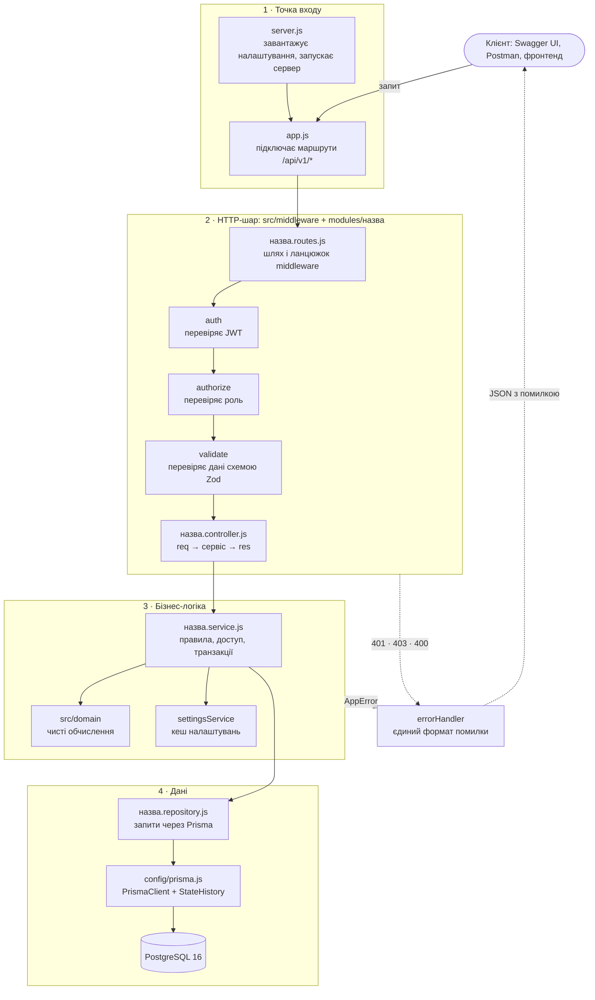
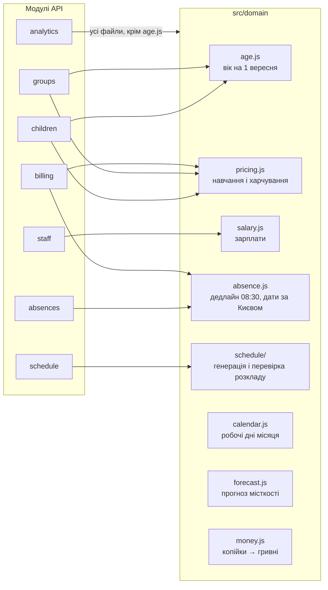

# Огляд проєкту kek_nodejs

Цей документ для розробника, який щойно приєднався до команди. Його мета: за пів години зрозуміти, що це за система, як вона влаштована, як її запустити й куди дивитися, щоб щось змінити.

Огляд пояснює загальну картину, а подробиці кожної теми описані в окремих документах у `docs/`. У кожному розділі нижче є посилання «Детальніше» на відповідний документ, а повний список документів — у [розділі 15](#15-що-читати-далі).

## Зміст

1. [Що це за система](#1-що-це-за-система)
2. [Стек](#2-стек)
3. [Як запустити](#3-як-запустити)
4. [Архітектура й структура](#4-архітектура-й-структура)
5. [Middleware і помилки](#5-middleware-і-помилки)
6. [Модулі й ендпоінти](#6-модулі-й-ендпоінти)
7. [Модель даних](#7-модель-даних)
8. [Налаштування і кеш](#8-налаштування-setting-і-кеш)
9. [Бізнес-логіка](#9-бізнес-логіка-де-що-рахується)
10. [Історія змін](#10-історія-змін-statehistory)
11. [Тести](#11-тести)
12. [Як додати новий ендпоінт](#12-як-додати-новий-ендпоінт-або-модуль)
13. [Процес роботи з git](#13-процес-роботи-з-git)
14. [Відомі обмеження](#14-відомі-обмеження)
15. [Що читати далі](#15-що-читати-далі)

## 1. Що це за система

Бекенд для приватного дитячого садка. Через REST API адміністрація веде дітей, батьків, групи, кімнати, персонал і гуртки, генерує тижневий розклад, рахує вартість навчання й харчування для батьків, приймає оплати та бачить фінансову аналітику з прогнозом прибутку.

Користувачі мають чотири ролі:

| Роль      | Хто це                                   | Що може                                                                                     |
| --------- | ---------------------------------------- | ------------------------------------------------------------------------------------------- |
| `ADMIN`   | власник садка                            | усе: налаштування цін і зарплат, знижки дітям, гуртки, кімнати, генерація й правка розкладу |
| `MANAGER` | менеджер                                 | операційна робота: діти, батьки, групи, персонал, аналітика; без налаштувань і знижок       |
| `TEACHER` | вихователь, помічник або викладач гуртка | бачить групи, кімнати, персонал і свій розклад                                              |
| `PARENT`  | батьки                                   | бачать лише своїх дітей, їхній розклад і рахунок; можуть дописати нотатку про дитину        |

Повні вимоги замовника (зарплати, ціни, ліміти) записані в розділі `REQUIREMENTS` у [README.md](../README.md). Там же є історія етапів: хто за що відповідав і що було зроблено.

## 2. Стек

- **Node.js 22** (див. `.nvmrc`), CommonJS-модулі (`require`).
- **Express 5**: маршрутизація; асинхронні помилки з обробників самі потрапляють в обробник помилок, тому `try/catch` у контролерах не потрібен.
- **PostgreSQL 16** у Docker і **Prisma 6** як ORM (схема в `prisma/schema.prisma`).
- **Zod 4**: валідація запитів і значень налаштувань.
- **JWT** (`jsonwebtoken`, токен живе 30 хв) і **bcryptjs** для паролів.
- **Jest 30 + Supertest**: unit- та інтеграційні тести, поріг покриття 95%.
- **Swagger UI**: інтерактивна документація API з `docs/openapi.yaml`.
- **ESLint + Prettier**: стиль коду.

## 3. Як запустити

### Варіант А: усе в Docker (найпростіше)

Потрібен лише Docker Desktop.

```bash
cp .env.example .env          # PowerShell: copy .env.example .env
docker compose up -d --build  # або npm run docker:up
docker compose logs -f app    # стежити за запуском
```

Контейнер застосунку сам застосовує міграції, заповнює базу тестовими даними (`SEED_ON_STARTUP=true`) і запускає `npm run dev` з автоперезапуском при зміні файлів.

Детальніше: [DOCKER.md → швидкий запуск](DOCKER.md#2-швидкий-запуск-all-in-docker), [як запускати npm-скрипти всередині контейнера](DOCKER.md#4-робота-зі-скриптами-packagejson).

### Варіант Б: Node.js локально, база в Docker

```bash
npm install
cp .env.example .env
npm run db:setup   # Postgres у Docker + міграції + seed
npm run dev        # http://localhost:3000
```

Детальніше: [DATABASE.md → швидкий старт](DATABASE.md#швидкий-старт) (там же описані всі змінні `.env`).

### Перевірка

- `GET http://localhost:3000/api/v1/health` повертає `{ "status": "ok" }`.
- `http://localhost:3000/api/docs` відкриває Swagger: там можна залогінитися й викликати будь-який ендпоінт.

### Тестові акаунти (створює seed)

| Роль    | Email                                                            | Пароль                                       |
| ------- | ---------------------------------------------------------------- | -------------------------------------------- |
| ADMIN   | `admin@kindergarten.local`                                       | `Admin123!` (змінна `ADMIN_PASSWORD`)        |
| MANAGER | `manager@kindergarten.local`                                     | `Password123!` (змінна `SEED_USER_PASSWORD`) |
| TEACHER | `teacher.music@…`, `educator.sonechko@…`, `assistant.sonechko@…` | `Password123!`                               |
| PARENT  | `parent.petrenko@example.com` та інші `parent.*@example.com`     | `Password123!`                               |

Логін: `POST /api/v1/auth/login` з `{ "email", "password" }`. У відповіді буде токен, його передають у заголовку `Authorization: Bearer <token>`.

Детальніше: [повний список акаунтів seed](DATABASE.md#тестові-облікові-записи-seed), [приклад логіну через cURL](AUTH.md#31-вхід-у-систему-login).

### Корисні команди

| Команда                           | Що робить                                              |
| --------------------------------- | ------------------------------------------------------ |
| `npm run dev`                     | сервер з автоперезапуском                              |
| `npm test` / `npm run test:cov`   | тести / тести з покриттям                              |
| `npm run lint` / `npm run format` | перевірка ESLint / форматування Prettier               |
| `npm run db:migrate`              | створити й застосувати нову міграцію після зміни схеми |
| `npm run db:seed`                 | заново заповнити тестові дані (seed ідемпотентний)     |
| `npm run db:reset`                | знести базу разом із даними й підняти з нуля           |
| `npm run db:studio`               | Prisma Studio: перегляд таблиць у браузері             |

Детальніше: [DATABASE.md → команди](DATABASE.md#команди).

**Після `git pull`**, якщо змінилися `package.json`, `prisma/schema.prisma` або з'явилися нові міграції, виконайте `npm install` і `npm run db:migrate`. Помилка `Cannot find module '.prisma/client/default'` у тестах означає, що Prisma Client не згенеровано: допоможе `npx prisma generate`.

## 4. Архітектура й структура

### 4.1. Шари і шлях запиту

Застосунок поділений на чотири шари, і кожен запит проходить їх згори донизу. Суцільні стрілки показують звичайний шлях запиту: успішну відповідь повертає контролер. Пунктирні стрілки показують шлях помилки: будь-який шар може кинути помилку, і `errorHandler` перетворить її на JSON-відповідь.



Що відповідає кожен шар:

| Шар           | Де лежить                                           | За що відповідає                                                                     | Чого не робить               |
| ------------- | --------------------------------------------------- | ------------------------------------------------------------------------------------ | ---------------------------- |
| Точка входу   | `src/server.js`, `src/app.js`                       | старт, підключення маршрутів, Swagger, обробка помилок                               | бізнес-логіки                |
| HTTP-шар      | `src/middleware/`, `*.routes.js`, `*.controller.js` | автентифікація, ролі, валідація вхідних даних, перетворення запиту на виклик сервісу | не звертається до БД напряму |
| Бізнес-логіка | `*.service.js`, `src/domain/`                       | правила садка, перевірки доступу до конкретних записів, транзакції, обчислення       | не знає про `req` і `res`    |
| Дані          | `*.repository.js`, `src/config/prisma.js`           | запити до PostgreSQL, вибір полів, блокування рядків                                 | не перевіряє бізнес-правила  |

`src/domain/` — особливий шар: це чисті функції, які отримують числа й повертають числа. Вони не знають ні про Express, ні про Prisma, тому їх легко тестувати й перевикористовувати. Детальніше про принцип: [DOMAIN.md → принципи](DOMAIN.md#1-принципи) і [як сервіси викликають domain](DOMAIN.md#6-як-використовувати-в-сервісах).

Контролери, сервіси й репозиторії — це класи, які отримують залежності через конструктор, і кожен файл експортує готовий екземпляр (`roomsService`, `roomsRepository`). Так у тестах легко підставити мок: `new RoomsService(fakeRepository, fakeSettings)`.

### 4.2. Які модулі на що спираються

Діаграма показує, які модулі API використовують обчислення з `src/domain/`. Модулі `auth`, `parents`, `clubs`, `rooms` і `settings` обходяться без domain, тому на ній їх немає.

Кеш налаштувань (`settingsService`) читають модулі `children`, `groups`, `rooms`, `staff`, `billing` і `analytics`.



### 4.3. Папки репозиторію

```
kek_nodejs/
├── src/
│   ├── server.js            # точка входу: завантажує налаштування з БД і запускає сервер
│   ├── app.js               # збирає Express-застосунок: маршрути, Swagger, обробка помилок
│   ├── config/
│   │   ├── index.js         # порт, JWT-секрет і термін токена з .env
│   │   └── prisma.js        # PrismaClient + автоматична історія змін (StateHistory)
│   ├── middleware/          # auth, authorize, validate, notFound, errorHandler
│   ├── errors/              # AppError і його нащадки, коди помилок
│   ├── domain/              # чиста бізнес-логіка без БД і HTTP
│   └── modules/<назва>/     # 12 модулів API, у кожному однаковий набір файлів:
│       ├── <назва>.routes.js
│       ├── <назва>.schema.js       # схеми Zod для валідації
│       ├── <назва>.controller.js
│       ├── <назва>.service.js
│       └── <назва>.repository.js
├── prisma/
│   ├── schema.prisma        # модель даних
│   ├── migrations/          # SQL-міграції
│   └── seed.js              # тестові дані
├── tests/
│   ├── unit/                # тести сервісів, репозиторіїв, domain і middleware з моками
│   └── integration/         # HTTP-тести через Supertest
├── docs/                    # документація модулів і openapi.yaml
├── Dockerfile, docker-compose.yml, docker-entrypoint.sh
└── .env.example             # шаблон змінних середовища
```

## 5. Middleware і помилки

- **`auth`** перевіряє заголовок `Authorization: Bearer <token>` і кладе розшифрований токен у `req.user` (`id`, `role`). Без токена або з простроченим токеном — 401.
- **`authorize('ADMIN', 'MANAGER')`** пропускає лише перелічені ролі, інакше повертає 403.
- **`validate(schema)`** перевіряє `body`, `query` і `params` схемою Zod з `<назва>.schema.js`. Перетворені значення (наприклад, `id` з рядка в число) записуються назад у `req`.
- **`notFound`** відповідає 404 на невідомий шлях.
- **`errorHandler`** перетворює будь-яку помилку на відповідь єдиного формату.

Детальніше: [AUTH.md → захист маршрутів](AUTH.md#23-захист-маршрутів-srcmiddlewareauthjs-та-authorizejs), [валідація](AUTH.md#22-валідація-srcmiddlewarevalidatejs).

Формат помилки завжди однаковий:

```json
{
  "error": {
    "code": "VALIDATION_ERROR",
    "message": "Validation failed",
    "details": [{ "path": "body.email", "message": "..." }]
  }
}
```

У сервісах кидайте класи з `src/errors/AppError.js`: `BadRequestError` (400), `UnauthorizedError` (401), `ForbiddenError` (403), `NotFoundError` (404), `ConflictError` (409). Помилки Prisma (`P2002` — дубль унікального поля, `P2025` — запис не знайдено тощо) сервіси перекладають у ці класи функцією `translateDbError`. Для помилок 5xx клієнт бачить лише загальне повідомлення, без деталей.

Детальніше: [AUTH.md → шар помилок](AUTH.md#21-шар-помилок-srcerrors).

## 6. Модулі й ендпоінти

Усі шляхи починаються з `/api/v1`. Повний опис запитів і відповідей є у Swagger (`/api/docs`) і в [openapi.yaml](openapi.yaml).

| Модуль      | Шлях                          | Що робить                                                                                                          | Детальніше                                                                                                            |
| ----------- | ----------------------------- | ------------------------------------------------------------------------------------------------------------------ | --------------------------------------------------------------------------------------------------------------------- |
| `auth`      | `/auth`                       | `POST /login`, `GET /me`                                                                                           | [AUTH.md](AUTH.md)                                                                                                    |
| `settings`  | `/settings`                   | ціни, зарплати, ліміти, свята; лише ADMIN                                                                          | [розділ 8](#8-налаштування-setting-і-кеш)                                                                             |
| `rooms`     | `/rooms`                      | кімнати груп і гуртків, ліміт 20                                                                                   | Swagger                                                                                                               |
| `groups`    | `/groups`                     | групи одного віку, до 20 дітей; `POST/DELETE /:id/children` — зарахування й виключення дитини                      | [GROUP.md](GROUP.md), [бізнес-правила](GROUP.md#4-бізнес-правила)                                                     |
| `children`  | `/children`                   | діти; `PATCH /:id/discount` — пільга (ADMIN); `DELETE` робить дитину неактивною, а не видаляє                      | [вік дитини](DOMAIN_AGE_SALARY.md#1-вік-дитини-srcdomainagejs), Swagger                                               |
| `absences`  | `/children/:childId/absences` | відсутності дитини; повідомлення до 08:30 за Києвом звільняє від оплати харчування за день                         | [ABSENCES.md](ABSENCES.md), [вплив на оплату](ABSENCES.md#6-вплив-на-billing)                                         |
| `parents`   | `/parents`                    | батьки та їхній зв'язок з дітьми; ADMIN і MANAGER                                                                  | [PARENTS_AND_STAFF.md → Parents](PARENTS_AND_STAFF.md#1-модуль-parents-apiv1parents)                                  |
| `staff`     | `/staff`                      | персонал чотирьох типів; `GET /:id/salary` — розрахунок зарплати                                                   | [PARENTS_AND_STAFF.md → Staff](PARENTS_AND_STAFF.md#2-модуль-staff-apiv1staff)                                        |
| `clubs`     | `/clubs`                      | 5 гуртків; один гурток — одна кімната й один викладач                                                              | [CLUBS.md](CLUBS.md), [видалення зі слотами](CLUBS.md#24-видалення-зі-слотами)                                        |
| `schedule`  | `/schedule`                   | `POST /generate` — автогенерація тижня; `GET /my` для викладача; `GET/DELETE /groups/:groupId`; `PATCH /slots/:id` | [SCHEDULE.md](SCHEDULE.md), [алгоритм генерації](SCHEDULE.md#24-алгоритм-генерації)                                   |
| `billing`   | `/billing/children/:childId`  | рахунок за місяць і рік; `GET /price-tag` — детальний цінник; `POST /payments` — оплата, зсуває `paidUntil`        | [PRICE_TAG.md](PRICE_TAG.md), [формули](PRICE_TAG.md#2-бізнес-правила-та-формули)                                     |
| `analytics` | `/analytics`                  | `GET /groups/:id/profit`, `GET /profit` (параметр `?month=YYYY-MM`), `POST /forecast`, `POST /forecast/schedule`   | [ANALYTICS.md](ANALYTICS.md), [алгоритм прогнозу](ANALYTICS.md#4-особливості-роботи-алгоритму-оптимізації-forecastjs) |

Обмеження доступу, які варто знати:

- Батьки бачать лише своїх дітей. Поля `discountPercent` і `hasDeputyRelatives` від них приховані, а змінювати вони можуть тільки `notes`.
- Викладач бачить розклад своєї групи або гуртка, бо обліковий запис `User` пов'язаний зі `Staff` через `Staff.userId`. Детальніше: [SCHEDULE.md → хто які групи бачить](SCHEDULE.md#26-хто-які-групи-бачить).
- Аналітика доступна ADMIN і MANAGER; налаштування, гуртки, кімнати (запис) і правка розкладу — лише ADMIN.

## 7. Модель даних

Основні таблиці (`prisma/schema.prisma`):

| Модель         | Суть                                                                                                       |
| -------------- | ---------------------------------------------------------------------------------------------------------- |
| `User`         | обліковий запис: email, хеш пароля, роль                                                                   |
| `Parent`       | батьки: ПІБ, телефон, борг; може мати `User` для входу                                                     |
| `Child`        | дитина: дата народження, нотатки, пільга, план оплати (`MONTHLY`/`YEARLY`), `paidUntil`, `isActive`, група |
| `ParentChild`  | зв'язок «багато до багатьох» між батьками й дітьми                                                         |
| `Room`         | кімната типу `GROUP` або `CLUB` з місячною вартістю                                                        |
| `Group`        | група: вік, кімната, вихователь і помічник (кожен може бути лише в одній групі)                            |
| `Staff`        | працівник: `EDUCATOR`, `ASSISTANT`, `CLUB_TEACHER`, `MANAGER`; `isActive`                                  |
| `Club`         | гурток з унікальними кімнатою та викладачем                                                                |
| `ScheduleSlot` | слот розкладу: група, день тижня, початок і кінець у хвилинах, активність, гурток                          |
| `Absence`      | відсутність дитини в конкретну дату й час повідомлення                                                     |
| `Setting`      | налаштування «ключ — JSON-значення»                                                                        |
| `StateHistory` | журнал змін усіх таблиць: стан до й після                                                                  |

Домовленості, яких треба триматися:

- **Гроші — цілі числа в копійках.** 15 000 грн зберігається як `1500000`. Назовні суми віддаються через `toMoney()` з `src/domain/money.js` у вигляді `{ uah, kopiykas }`. Ніколи не рахуйте гроші в дробових гривнях.
- **Час розкладу — хвилини від півночі.** 08:30 = `510`, день тижня 1–5 (Пн–Пт). Детальніше: [SCHEDULE.md → слот розкладу](SCHEDULE.md#22-слот-розкладу).
- **Дати народження, `paidUntil`, відсутності** зберігаються як дата без часу (`@db.Date`). Усе, що залежить від «сьогодні», рахується за часовим поясом `Europe/Kyiv`.
- **Дітей не видаляють:** `DELETE /children/:id` робить дитину неактивною (`isActive = false`), щоб не губити історію й фінанси. Працівника можна звільнити через `isActive = false` або видалити (`DELETE /staff/:id`), але видалення заборонене, поки він закріплений за групою чи гуртком.
- **Зміну схеми БД** оформлюйте міграцією: змініть `schema.prisma`, виконайте `npm run db:migrate`, дайте міграції зрозумілу назву й закомітьте папку з `prisma/migrations/`. Детальніше: [DATABASE.md → зміна схеми](DATABASE.md#зміна-схеми).

## 8. Налаштування (`Setting`) і кеш

Ціни, зарплати, ліміти й свята не зашиті в код, а лежать у таблиці `Setting`. Їхній перелік, значення за замовчуванням і правила валідації описані в одному місці: `src/modules/settings/settings.definitions.js`.

- При старті `server.js` викликає `settingsService.load()`, і всі значення кешуються в пам'яті.
- У коді значення читають синхронно: `settingsService.get('TUITION_MONTHLY')`. Ключ передається у форматі `CONSTANT_CASE`, а в БД зберігається в `camelCase` (`tuitionMonthly`).
- ADMIN змінює значення через `PUT/PATCH /api/v1/settings/:key`. Кеш оновлюється одразу. Якщо змінили значення прямо в БД, викличте `POST /api/v1/settings/reload`.
- Щоб додати нове налаштування, впишіть його в `SETTING_DEFINITIONS` (default + схема Zod) і, за потреби, у `prisma/seed.js`.

Основні ключі: `tuitionMonthly` (15 000 грн), `yearlyDiscountPercent` (12), `discountLevels` ([10, 20, 30]), `holidays` (список дат), `mealBasePerDay` (300 грн) і `mealPerExtraYear` (+100 грн), `roomMonthlyCost` (50 000 грн), `defaultRoomsCount` (20), `maxChildrenInGroup` (20), `maxGroups` (30), `workingDaysPerMonth` (21), `attendanceRatePercent` (80), а також ставки зарплат.

Детальніше: [DOMAIN.md → як сервіс передає налаштування в domain](DOMAIN.md#6-як-використовувати-в-сервісах).

## 9. Бізнес-логіка: де що рахується

Обчислення лежать у `src/domain/`, і саме туди варто дивитися, якщо питання звучить «а як рахується…».

| Файл          | Що рахує                                                                                                                                 | Детальніше                                                                                             |
| ------------- | ---------------------------------------------------------------------------------------------------------------------------------------- | ------------------------------------------------------------------------------------------------------ |
| `age.js`      | вік дитини на 1 вересня поточного навчального року (допустимо 2–5 років)                                                                 | [DOMAIN_AGE_SALARY.md → вік](DOMAIN_AGE_SALARY.md#1-вік-дитини-srcdomainagejs)                         |
| `pricing.js`  | навчання зі знижками (пільга та 12% за рік перемножуються), харчування за віком групи, цінник з порівнянням планів                       | [DOMAIN.md → вартість](DOMAIN.md#5-вартість-для-батьків-pricingjs), [PRICE_TAG.md](PRICE_TAG.md)       |
| `salary.js`   | зарплати: вихователь — ставка за дитину, помічник — оклад, обом доплата, якщо в групі понад 12 дітей; викладач гуртка й менеджер — оклад | [DOMAIN_AGE_SALARY.md → зарплати](DOMAIN_AGE_SALARY.md#2-зарплати-персоналу-srcdomainsalaryjs)         |
| `absence.js`  | чи вкладається повідомлення про відсутність у дедлайн 08:30 за Києвом; робота з датами в цьому часовому поясі                            | [ABSENCES.md → бізнес-правила](ABSENCES.md#5-бізнес-правила)                                           |
| `calendar.js` | робочі дні місяця: Пн–Пт мінус свята з налаштування `holidays`                                                                           | [DOMAIN.md → робочий календар](DOMAIN.md#55-робочий-календар-calendarjs)                               |
| `schedule/`   | шаблон дня, генерація тижневого розкладу без накладок кабінетів і викладачів, перевірка ручних правок                                    | [SCHEDULE.md → алгоритм генерації](SCHEDULE.md#24-алгоритм-генерації)                                  |
| `forecast.js` | прогноз: скільки груп, кімнат і персоналу потрібно для заданої кількості дітей і який буде прибуток                                      | [ANALYTICS.md → алгоритм прогнозу](ANALYTICS.md#4-особливості-роботи-алгоритму-оптимізації-forecastjs) |
| `money.js`    | переведення копійок у `{ uah, kopiykas }`                                                                                                | —                                                                                                      |

Кілька правил, про які легко забути:

- Навчання оплачується повністю незалежно від відвідуваності, а харчування — лише за робочі дні мінус своєчасно повідомлені відсутності.
- На харчування знижки не діють.
- Пільгу, яку адмін прибрав зі списку рівнів, дитина зберігає; рівень перевіряється лише в момент призначення.
- Зарахування дитини в групу виконується в транзакції з блокуванням рядка групи (`SELECT … FOR UPDATE`), щоб дві паралельні заявки не переповнили групу. Детальніше: [GROUP.md → бізнес-правила](GROUP.md#4-бізнес-правила).

## 10. Історія змін (`StateHistory`)

`src/config/prisma.js` розширює Prisma Client: кожна операція `create`, `update`, `delete` і `upsert` над будь-якою таблицею записує в `StateHistory` стан до й після. Писати це вручну не потрібно.

Якщо операція виконується в інтерактивній транзакції (`prisma.$transaction(async (tx) => …)`), записи історії накопичуються й зберігаються лише після успішного завершення транзакції. Після відкату їх не буде. Масові операції (`createMany`, `updateMany`, `deleteMany`) у журнал не потрапляють.

Детальніше: [DATABASE.md → State History](DATABASE.md#навчальний-антипатерн-збереження-всіх-стейтів-даних-state-history) — там описано, як це реалізовано і чому такий підхід вважається антипатерном.

## 11. Тести

- `tests/unit/` — тести окремих класів і функцій. Залежності (репозиторій, налаштування) підставляються моками через конструктор, БД не потрібна.
- `tests/integration/` — HTTP-тести через Supertest на `createApp()`. Більшість з них мокають сервіси або репозиторії, тож теж працюють без БД.
- Файли `*.db.test.js` ходять у справжній PostgreSQL. Якщо база недоступна, вони пропускаються з попередженням.
- Поріг покриття — 95% за всіма метриками (`jest.config.js`); якщо нижче, `npm run test:cov` впаде.
- Тести, що залежать від поточної дати (календар, відсутності, аналітика), фіксують дату через параметр `now` у конструкторі сервісу або `jest.spyOn(service, 'now')`. Не пишіть тести, які проходять лише в певний місяць.

Перед PR обов'язково: `npm test`, `npm run lint`, `npm run format:check`.

Детальніше: [UNIT_TESTS.md → рівні тестування](UNIT_TESTS.md#3-стратегія-та-рівні-тестування), [критерії приймання](UNIT_TESTS.md#6-критерії-приймання-тестування-definition-of-done).

## 12. Як додати новий ендпоінт або модуль

1. Якщо потрібна нова таблиця чи поле, змініть `prisma/schema.prisma` і створіть міграцію (`npm run db:migrate`).
2. Створіть папку `src/modules/<назва>/` з п'ятьма файлами за зразком невеликого модуля, наприклад `rooms`.
3. Опишіть вхідні дані Zod-схемою в `<назва>.schema.js` у форматі `z.object({ params, query, body })`.
4. У `<назва>.routes.js` підключіть `auth`, `authorize(...)` і `validate(...)`.
5. Обчислення, які не залежать від БД, винесіть у `src/domain/`.
6. Підключіть router в `src/app.js`.
7. Додайте unit- та інтеграційні тести, щоб покриття лишилося не нижче 95%.
8. Опишіть ендпоінт у `docs/openapi.yaml` і перевірте його у Swagger (`/api/docs`). Файл читається при старті застосунку, тож помилка в YAML не дасть серверу запуститися. Якщо модуль великий, додайте `docs/<НАЗВА>.md` і посилання на нього в цей огляд.

## 13. Процес роботи з git

- Основна гілка — `main`. Нова робота ведеться в окремій гілці: `feature/<що-робимо>`, `fix/<що-виправляємо>`, `chore/<обслуговування>`, `docs/<документація>`.
- Зміни потрапляють у `main` лише через Pull Request з рев'ю.
- Повідомлення комітів пишемо у стилі Conventional Commits: `feat(billing): …`, `fix(analytics): …`, `docs: …`, `chore: …`.
- Команда працює етапами по тижню з ротацією ролей (Team Lead, BA, QA, Dev). Хто за що відповідав на кожному етапі й що було зроблено, записано в [README.md](../README.md).
- Не комітьте `.env`; для нових змінних оновлюйте `.env.example`.

## 14. Відомі обмеження

- Білінг рахує харчування за фіксованими 21 робочим днем (налаштування `workingDaysPerMonth`), а аналітика й прогноз — за реальним календарем місяця зі святами. У місяцях з іншою кількістю робочих днів суми в рахунку батьків і в аналітиці відрізняються.
- Свята не підтягуються автоматично: адміністратор вносить їх у налаштування `holidays` вручну. Seed містить свята на 2026–2027 роки.
- Немає refresh-токенів: через 30 хвилин потрібно залогінитися знову.
- У `src/config/index.js` є запасний JWT-секрет для розробки. На будь-якому реальному сервері обов'язково задавайте `JWT_SECRET` у середовищі.
- Для `StateHistory` немає ендпоінтів перегляду: журнал можна подивитися лише в БД, наприклад через `npm run db:studio`.

## 15. Що читати далі

| Документ                                     | Про що                                             |
| -------------------------------------------- | -------------------------------------------------- |
| [DATABASE.md](DATABASE.md)                   | локальна база, змінні `.env`, seed, `StateHistory` |
| [DOCKER.md](DOCKER.md)                       | запуск у Docker, npm-скрипти всередині контейнера  |
| [AUTH.md](AUTH.md)                           | автентифікація, JWT, ролі, валідація, помилки      |
| [DOMAIN.md](DOMAIN.md)                       | формули цін і знижок, робочий календар             |
| [DOMAIN_AGE_SALARY.md](DOMAIN_AGE_SALARY.md) | вік дитини і зарплати                              |
| [GROUP.md](GROUP.md)                         | групи й зарахування дітей                          |
| [PARENTS_AND_STAFF.md](PARENTS_AND_STAFF.md) | батьки й персонал                                  |
| [ABSENCES.md](ABSENCES.md)                   | відсутності та їхній вплив на оплату               |
| [CLUBS.md](CLUBS.md)                         | гуртки                                             |
| [SCHEDULE.md](SCHEDULE.md)                   | розклад і алгоритм генерації                       |
| [PRICE_TAG.md](PRICE_TAG.md)                 | цінник і білінг                                    |
| [ANALYTICS.md](ANALYTICS.md)                 | прибуток, календар і прогноз                       |
| [UNIT_TESTS.md](UNIT_TESTS.md)               | стратегія тестування                               |
| [openapi.yaml](openapi.yaml)                 | специфікація API (у браузері — `/api/docs`)        |
